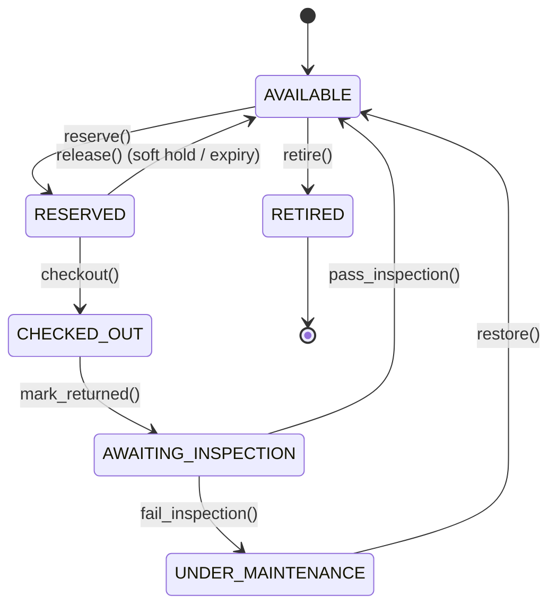
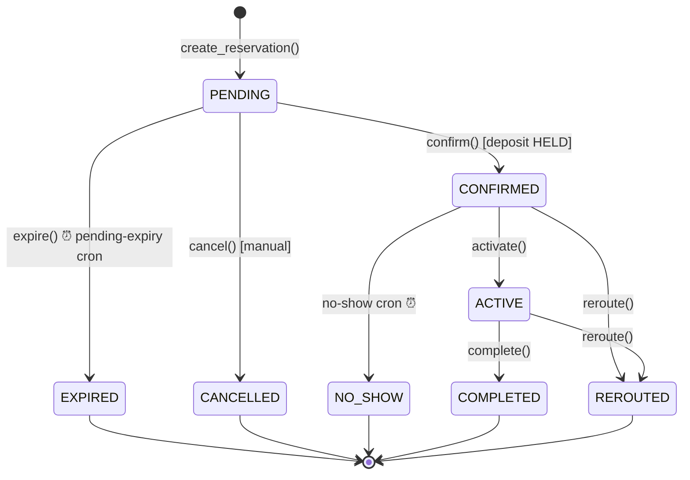
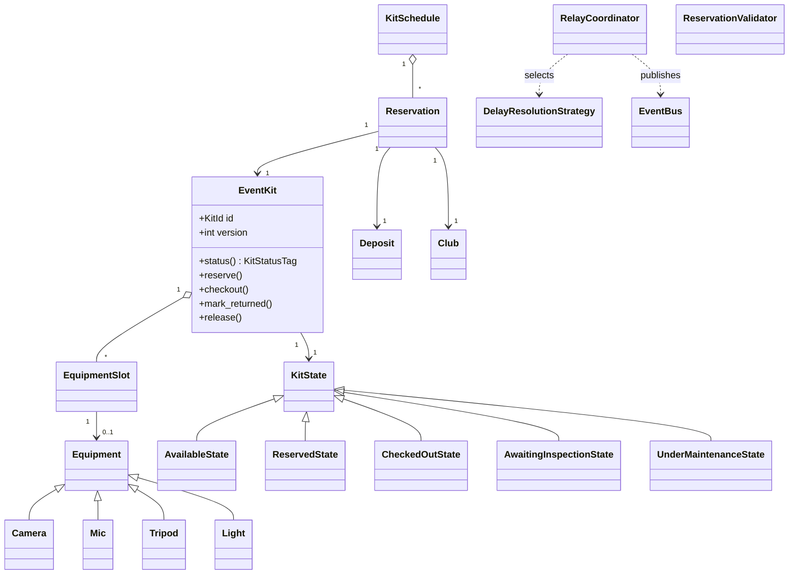

# Diagrams

## Kit lifecycle (State pattern)



## Reservation lifecycle (with crons)



## Confirm vs pending-expiry race

```mermaid
sequenceDiagram
    participant Club
    participant Svc as ReservationService
    participant Cron as PendingExpirySweep
    participant Lock as LockManager
    Note over Club,Cron: reservation is PENDING, hold_expires_at reached
    par Club confirms
        Club->>Svc: confirm(rid)
        Svc->>Lock: acquire(kit_id)
        Svc->>Svc: reload; status==PENDING -> CONFIRMED; commit
        Svc->>Lock: release
    and Cron fires
        Cron->>Lock: acquire(kit_id)  (blocks until released)
        Cron->>Cron: reload; status==CONFIRMED -> no-op
    end
```

## Domain class diagram


